# How To Use video_explainer

A map of what this project can do, which feature to pick for a given job, and which document to read.
Start with the decision table, then follow the links.

## Github repo
Confirm the active account with a switch:
gh auth switch -u guideaxon
git push --dry-run

## 1. What this project is

A pipeline that turns documents (or your own screenshots and ideas) into narrated, animated videos.
Python CLI (`src/cli`) does parsing, LLM steps, TTS, storyboard and rendering. Remotion/React
(`remotion/`) draws the animation. LLM steps shell out to Claude Code (`claude-sonnet-5-5`).

It has **two families of output**:

| Family | What you get | Driven by |
|---|---|---|
| **A. Explainer pipeline** | Long 16:9 (1920x1080) technical explainers from a paper or article, plus vertical shorts cut from them | CLI commands (`generate`, `short`, `refine`, `sound`, ...) |
| **B. Style Bundle videos** | Styled videos with a fixed look: 7 style bundles, mostly portrait 1080x1920 | A style bundle **skill** (`/markets_make_video`, ...) which scaffolds from templates |

Family A is general and automated. Family B is opinionated: each style bundle has its own style guide,
Remotion kit, templates and skill, and styles are never mixed.

## 2. Which feature do I use when?

| I want to... | Use | Read |
|---|---|---|
| Turn a paper / article / URL into a full explainer video | `generate <project>` (plan, script, narration, scenes, voiceover, storyboard, render) | [CLI.md](CLI.md), README |
| Run or re-run a single pipeline step | `plan`, `script`, `narration`, `scenes`, `voiceover`, `storyboard`, `render` | [CLI.md](CLI.md) |
| Fix chunked-render memory problems, pick a resolution | `render --chunk`, resolution presets | [CLI.md](CLI.md) (Chunked Rendering, Resolution Presets) |
| Improve an explainer's quality (gaps, wording, visuals, timing) | `refine` (5 phases: analyze, script, visual-cue, visual, sync) | [REFINEMENT.md](REFINEMENT.md) |
| Make a vertical short (TikTok/Reels/Shorts) from an explainer | `short generate` (hook or summary mode), `render --short` | [SHORTS.md](SHORTS.md) |
| Add sound effects and background music | `sound`, `music` | [SOUND.md](SOUND.md) |
| Check facts against source / apply written feedback | `factcheck`, `feedback` | [CLI.md](CLI.md) (Quality Assurance) |
| Know the layout, typography, citation and animation rules for explainer scenes | Production standards | [VIDEO_PRODUCTION_GUIDELINES.md](VIDEO_PRODUCTION_GUIDELINES.md) |
| Make a Vantage (GuideAxon) vertical short | `/vantage_make_short` | [vantage_video_style_guide.md](vantage_video_style_guide.md) |
| Make a market-story explainer (charts, sectors, sentiment) | `/markets_make_video` | [markets_video_style_guide.md](markets_video_style_guide.md) |
| Make a SaaS product-launch promo | `/promo_make_video` | [promo_video_style_guide.md](promo_video_style_guide.md) |
| Make a playful consumer-app launch teaser | `/launch_make_video` | [launch_video_style_guide.md](launch_video_style_guide.md) |
| Make an animated lyric / music video | `/lyric_make_video` | [lyric_video_style_guide.md](lyric_video_style_guide.md) |
| Make a pixel-bot business explainer or satire | `/leaderbot_make_video` | [leaderbot_video_style_guide.md](leaderbot_video_style_guide.md) |
| Make a narrated product demo from real screenshots (no screen recording) | `/demo_make_video` | [demo_video_style_guide.md](demo_video_style_guide.md) |
| Make a neon synthwave story or explainer with a glowing robot host | `/neon_make_video` | [neon_video_style_guide.md](neon_video_style_guide.md) |
| Make a retro 1930s rubber-hose cartoon with a noodle-limbed host | `/rubberhose_make_video` | [rubberhose_video_style_guide.md](rubberhose_video_style_guide.md) |
| Make a glossy vinyl-toy product explainer or launch teaser | `/glossy_make_video` | [glossy_video_style_guide.md](glossy_video_style_guide.md) |
| Make a claymation-look explainer with a clay character | `/clay_make_video` | [clay_video_style_guide.md](clay_video_style_guide.md) |
| Make a comic pop-art story or explainer with an inked hero | `/popart_make_video` | [popart_video_style_guide.md](popart_video_style_guide.md) |
| Make a code-built 3D scene (soap bubbles, physics) as a video and a playable HTML page | `/scene3d_make_video` | [scene3d_video_style_guide.md](scene3d_video_style_guide.md), [scene3d_design.md](scene3d_design.md) |
| Check a style bundle video before voiceover | `scripts/review_video.py <project> --brief` | [video_review_checklist.md](video_review_checklist.md) |
| Understand why the Vantage and Markets style bundles look the way they do | Design rationale and notes | [VantageVideoTemplate.md](VantageVideoTemplate.md) |

### Quick chooser

- Have a **document to explain**, landscape, with citations? Family A (`generate`).
- Want a **short teaser of that explainer**? Family A (`short generate`).
- Have a **topic or product, and want a branded vertical video in a set look**? Family B, pick a style bundle by subject:
  data/markets = Markets, SaaS launch = Promo, consumer app = Launch, song = Lyric, business satire = Leaderbot,
  your own screenshots = Demo, GuideAxon = Vantage.

## 3. Documentation map

```mermaid
flowchart TD
    HTU["HowToUse.md<br/>(you are here)"]
    README["README.md<br/>features, architecture"]
    CLAUDE["CLAUDE.md<br/>env setup, style bundle table, conventions"]

    HTU --> README
    HTU --> CLAUDE

    subgraph A["Family A: explainer pipeline (16:9 + shorts)"]
        CLI["CLI.md<br/>every command and option"]
        GUIDE["VIDEO_PRODUCTION_GUIDELINES.md<br/>layout, citations, typography, animation"]
        REF["REFINEMENT.md<br/>5-phase quality system"]
        SHORTS["SHORTS.md<br/>vertical shorts, hook/summary"]
        SOUND["SOUND.md<br/>SFX and MusicGen music"]
    end

    subgraph B["Family B: style bundle videos"]
        CORE["video_make_core skill<br/>shared workflow"]
        CHK["video_review_checklist.md<br/>pre-render review"]
        VAN["vantage_video_style_guide.md"]
        MKT["markets_video_style_guide.md"]
        PRO["promo_video_style_guide.md"]
        LAU["launch_video_style_guide.md"]
        LYR["lyric_video_style_guide.md"]
        LBT["leaderbot_video_style_guide.md"]
        DEM["demo_video_style_guide.md"]
        NOTES["VantageVideoTemplate.md<br/>design notes behind Vantage + Markets"]
        RIG["CHARACTER_RIG.md<br/>how characters talk, blink, walk, make sound"]
        STY["ANIMATION_STYLES.md<br/>the 12 styles: coverage and open work"]
    end

    HTU --> CLI
    HTU --> CORE
    CLI --> REF
    CLI --> SHORTS
    CLI --> SOUND
    SHORTS --> SOUND
    GUIDE -. "general defaults" .-> CLI
    GUIDE -. "style bundles override" .-> VAN
    SHORTS --> VAN

    CORE --> CHK
    CORE --> MKT
    CORE --> PRO
    CORE --> LAU
    CORE --> LYR
    CORE --> LBT
    CORE --> DEM
    CORE -.-> RIG
    RIG --> STY
    RIG -. "sound cues" .-> SOUND
    CHK -. "copy and data rules" .-> MKT
    NOTES -.-> VAN
    NOTES -.-> MKT
```

Solid arrows mean "go next / depends on"; dotted arrows mean "related or overridden by".

### Map in words

- **Entry points:** `HowToUse.md` (this file) leads to `README.md` (features, architecture) and `CLAUDE.md`
  (setup, style bundle table, conventions).
- **Explainer pipeline:** `CLI.md` is the hub, listing every command. Three docs expand on one command group each:
  `REFINEMENT.md` (`refine`), `SHORTS.md` (`short`) and `SOUND.md` (`sound`, `music`). Shorts also use
  SOUND for music. `VIDEO_PRODUCTION_GUIDELINES.md` sets the default look of scenes; style bundles override it.
- **Style bundle videos:** the shared `video_make_core` skill is the hub for Markets, Promo, Launch, Lyric, Leaderbot
  and Demo. It sends you to `video_review_checklist.md` before voiceover and to the style bundle's style guide for
  look, copy and data rules. Vantage skips `video_make_core` and builds on SHORTS.md plus its own guide.
- **Characters:** `CHARACTER_RIG.md` is the design of the shared character rig (talk, blink, gesture, walk, lip sync,
  sound cues). `ANIMATION_STYLES.md` maps the 12 animation styles to bundles and lists what is still open.
- **Background reading:** `VantageVideoTemplate.md` explains the thinking behind the Vantage and Markets styles.

## 4. Typical workflows

### A1. Long explainer from a document
1. Put the source in `projects/<project>/input/`, then `python -m src.cli create <project>`.
2. `generate <project>` runs plan, script, narration, scenes, voiceover, storyboard, render
   (use `--from` / `--to` / `--interactive` to control it). See [CLI.md](CLI.md).
3. Raise quality with `refine` ([REFINEMENT.md](REFINEMENT.md)); add audio with `sound` and `music`
   ([SOUND.md](SOUND.md)); verify with `factcheck` ([CLI.md](CLI.md)).
4. Scenes must follow [VIDEO_PRODUCTION_GUIDELINES.md](VIDEO_PRODUCTION_GUIDELINES.md) (see its pre-render checklist).

### A2. Short from an explainer
Needs `script` and `narration` done first. `short generate <project>` then `render <project> --short`.
Modes, variants and timing sync: [SHORTS.md](SHORTS.md). Music for shorts: [SOUND.md](SOUND.md).

### B. Style Bundle video (all style bundles except Vantage)
1. Invoke the style bundle skill (for example `/promo_make_video`). It loads `video_make_core`.
2. Scaffold the project from `templates/<style_bundle>_video/` with `scripts/<style_bundle>_new_video.py`
   (Demo scaffolds from screenshots and `manifest.json` instead).
3. Hand-adapt the scenes and narration to the style guide (Demo: edit the manifest and run
   `demo_build_scenes.py`; never hand-edit generated scenes).
4. **Review before voiceover:** `scripts/review_video.py <project> --brief`
   ([video_review_checklist.md](video_review_checklist.md)).
5. `voiceover`, then `scripts/<style_bundle>_finalize_storyboard.py`, then `render`.
6. Inspect rendered frames (mid-beat and end-of-beat) before calling it done.

### B2. Vantage short (different workflow)
Vantage does not use `video_make_core`. It reuses the Family A short pipeline with a hand-edited script
(skill `.claude/skills/vantage_make_short/`):
1. `create <project>`; write `input/source.md` as marketing copy (true claims only).
2. `script`, `narration`, then `short script --mode summary --duration 45 --variant <v>`.
3. Hand-edit `short/<v>/short_script.json` (70-80 words of narration, style bundle CTA such as "Link in bio").
4. `short voiceover --provider edge`, then `scripts/vantage_new_short.py <project> --variant <v>`
   (copies `templates/vantage_short/`, sets the style bundle, adds the renderer stub).
5. `short storyboard --skip-custom-scenes`, adapt `Beat*.tsx` scenes, `render <project> --short --variant <v>`.
6. Inspect frames mid-beat and end-of-beat, then promote reusable changes to `templates/`.

## 4a. The shared skill: video_make_core

[`.claude/skills/video_make_core/SKILL.md`](../.claude/skills/video_make_core/SKILL.md) is the one skill common to
style bundles. It is not invoked directly: a style bundle skill loads it first and supplies the style bundle's values
(`<style_bundle>`, style guide, kit, templates, scripts, narration length, pacing).

**What it holds:** the common Windows setup, and the 11-step workflow: create project, scaffold, gather real
content, edit scenes and narration (registry key = title slug), pre-render review, voiceover, finalize
storyboard and pacing, render, verify (frames, audio levels), social export, promote reusable changes. It also
lists common pitfalls and says to add style-bundle-specific review rules in the `STYLE_BUNDLES` dict of
`scripts/review_video.py`.

**Who uses it:** Markets, Promo, Launch, Lyric, Leaderbot and Demo (per `CLAUDE.md`).

**What it does not cover:**
- Vantage, which has its own skill (`vantage_make_short`) and the shorts pipeline (see B2).
- The Family A explainer pipeline (`generate`, `refine`, `sound`); only the docs cover it, no skill wraps it.

**Known inconsistency:** the skill's description still names only Markets, Promo, Launch and Lyric, so Leaderbot
and Demo are not listed there even though they depend on it.

## 5. Style Bundle cheat sheet

| Style Bundle | Format | Look in one line | Kit | Template / scaffold |
|---|---|---|---|---|
| Vantage | 1080x1920 short, about 40 s | Editorial line art, parchment vs midnight, Cinzel + Plex Mono | `components/vantage/` | `templates/vantage_short/`, `vantage_new_short.py` |
| Markets | 1080x1920, 45-60 s | Data journalism: paper vs terminal, semantic green/red, handwritten notes | `components/markets/` | `templates/markets_video/`, `markets_new_video.py` |
| Promo | 1080x1920 | Dark glossy glass UI, teal-blue gradient, kinetic headlines | `components/promo/` | `templates/promo_video/`, `promo_new_video.py` |
| Launch | 1080x1920, 25-35 s | Bright playful, evolving mascot, phone mockups | `components/launch/` | `templates/launch_video/`, `launch_new_video.py` |
| Lyric | 1080x1920, 30-90 s | Kawaii retro-pixel pastel pop, one vignette per lyric line | `components/lyric/` | `templates/lyric_video/`, `lyric_new_video.py` |
| Leaderbot | 1080x1920, 25-35 s | Flat blocky pixel mosaic, hard shadows, no gradients | `components/leaderbot/` | `templates/leaderbot_video/`, `leaderbot_new_video.py` |
| Popart | 1080x1920, 25-35 s | Comic pop-art: inked panels, Ben-Day halftone dots, POW starbursts, speech balloons | `components/popart/` | `templates/popart_video/`, `popart_new_video.py` |
| Clay | 1080x1920, 25-35 s | Claymation look: matte plasticine, fingerprint texture, stop-motion on twos, felt set | `components/clay/` | `templates/clay_video/`, `clay_new_video.py` |
| Glossy | 1080x1920, 25-40 s | Glossy toy 3D-look: shiny vinyl, gradient gloss, springy squash-and-stretch, pastel sweep | `components/glossy/` | `templates/glossy_video/`, `glossy_new_video.py` |
| Rubberhose | 1080x1920, 25-35 s | Retro 1930s rubber-hose cartoon: noodle limbs, film grain, animated on twos | `components/rubberhose/` | `templates/rubberhose_video/`, `rubberhose_new_video.py` |
| Neon | 1080x1920, 25-35 s | Neon synthwave: glowing stroke-only tubes, perspective grid, striped sun, chrome type | `components/neon/` | `templates/neon_video/`, `neon_new_video.py` |
| Demo | 1920x1080 (or `--portrait`) | Real screenshots in device frames, camera zooms, cursor, step tracker | `components/demo/` | `manifest.json`, `demo_new_video.py`, `demo_build_scenes.py` |
| Scene3d | 1920x1080, 10-30 s, plus `scene.html` | Code-built three.js: thin-film soap bubbles, breeze, pops, studio sweep with bokeh; seeded baked simulation | `components/scene3d/` on `components/three-core/` | `templates/scene3d_video/`, `scene3d_new_video.py`, `three_core_bake_sim.mjs` |

All kits live under `remotion/src/components/`. Each style bundle's finalize script is
`scripts/<style_bundle>_finalize_storyboard.py` (shared helper `scripts/_storyboard_pacing.py`).
A project picks its style bundle with `"style_bundle": "<name>"` in `projects/<project>/config.json`.

## 6. Setup reminders (Windows)

- Python 3.14 in `.venv`, Node 22, ffmpeg on PATH. Set `PYTHONUTF8=1` for every Python command.
- Run the CLI as `.venv\Scripts\python.exe -m src.cli ...`; install Remotion deps with `cd remotion && npm install`.
- `projects/` is gitignored: put anything reusable in `templates/`, `docs/`, `remotion/src/components/` or `.claude/skills/`.
- Full details: [CLAUDE.md](../CLAUDE.md).

## 7. Documentation gaps worth knowing

- [VantageVideoTemplate.md](VantageVideoTemplate.md) is working notes (a proposal plus reference-clip analysis),
  not a how-to. The authoritative Vantage and Markets rules are in their style guides.
- [VIDEO_PRODUCTION_GUIDELINES.md](VIDEO_PRODUCTION_GUIDELINES.md) defaults assume dark 1920x1080 explainer
  scenes; they do not apply to style bundle videos.
- `README.md` still shows the older example videos and a color/typography section for the explainer style only.
